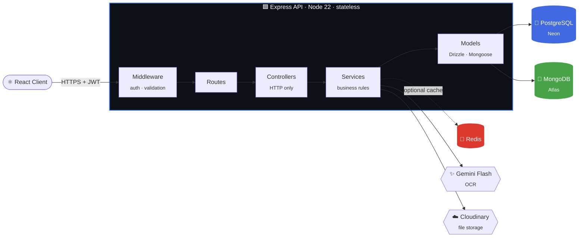
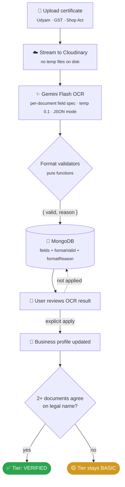

<div align="center">


**A Virtual Shark Tank. Businesses pitch. Investors browse, match, and make offers.**

*Where OCR, format validation, and cross-document consistency decide who gets to be called* **verified**.

<br/>

[](https://github.com/aniruddha9674/smartshark/actions)
[](#-testing)
[](#-whats-built)
[](#)

<br/>


<br/>

[**Architecture**](#-architecture) &nbsp;·&nbsp;
[**Verification**](#-the-verification-pipeline) &nbsp;·&nbsp;
[**Docs**](#-documentation) &nbsp;·&nbsp;
[**Status**](#-status) &nbsp;·&nbsp;
[**What's built**](#-whats-built) &nbsp;·&nbsp;
[**Run locally**](#-run-locally) &nbsp;·&nbsp;
[**Decisions**](#-key-decisions)

</div>

<br/>

---

## 🦈 What this is

SmartShark is a **backend-first investment marketplace**.

| 🏢 Business owner | 💼 Investor |
|---|---|
| Builds a profile | Browses a matched feed |
| Verifies registration documents | Shortlists businesses to follow up on |
| Publishes a pitch | Chats with founders |
| Receives offers from matched investors | Negotiates deals |

> **Deals close atomically.** Offer accepted → siblings rejected → pitch funded → investment created → conversation opened. All in **one Postgres transaction**. Either every step happens or none of them do.

The interesting part isn't the CRUD. It's the **document verification pipeline**:

- 🔍 **OCR** extracts fields from Indian business certificates (Udyam, GST, Shop Act)
- ✅ **Pure-function validators** check each identifier against real-world format rules: GSTIN's mod-36 checksum, Udyam state codes, PAN holder types
- 🤝 **Cross-document consistency**: a business is upgraded to *verified* only when two independent documents agree on the legal name

<br/>

## 🏗 Architecture

> One process. Two databases. Five internal layers. Controllers never touch the database. Services never touch HTTP. The API is stateless, so horizontal scaling costs nothing beyond adding instances.



Full architecture → [`overview.md`](./overview.md)

<br/>

## 🔐 The verification pipeline

*The part of the system that isn't CRUD.*



| Validator | What it checks |
|---|---|
| **GSTIN** | Mod-36 checksum |
| **Udyam** | State code whitelist |
| **PAN** | Holder type |
| **Shop Act** | Registration format |

> [!IMPORTANT]
> **Never writes to the business profile without user confirmation.** The apply step is a separate, explicit action. OCR results sit in Mongo until the user decides what to keep.

> [!NOTE]
> **Cross-document consistency is the whole point.** If the Udyam certificate says `Acme Pvt Ltd` and the GST certificate says `Acme Private Limited`, the tier stays at **basic**, even though both documents verified successfully. Two documents that disagree aren't evidence of anything.

Full pipeline → [`database.md` §7](./database.md)

<br/>

## 📚 Documentation

| | Doc | What it covers |
|:-:|---|---|
| 🗺️ | [`overview.md`](./overview.md) | Architecture, security model, scaling plan, design principles |
| ⚙️ | [`logic.md`](./logic.md) | Request flow, routes, controllers, services, middleware, testing |
| 🗄️ | [`database.md`](./database.md) | Schema, relationships, indexes, migrations, verification pipeline |

> **New here?** Read them in that order. Overview gives you the map. Logic shows how requests move through the code. Database explains what's stored and why.

<br/>

## 🚦 Status

| Phase | Feature | State |
|:-:|---|:-:|
| 1 | Auth: JWT, refresh rotation, ownership-based authorization | ✅ Done |
| 2 | Business + investor profiles | ✅ Done |
| 3 | Pitches: full lifecycle (`draft → live → closed → funded`) | ✅ Done |
| 4 | Follows + conversations | ✅ Done |
| 5 | Matching: rule-based five-factor scorer | ✅ Done |
| 6 | Offers: counter threads, atomic acceptance | ✅ Done |
| 7 | Verification: OCR, format validators, cross-doc consistency | ✅ Done |
| 8 | Fuzzy business search: `pg_trgm` GIN index | ✅ Done |
| 9 | Readiness scoring | 🟡 Rules-based · ML pending |
| 10 | Admin verification review queue | 🟡 Backend done · UI pending |
| 11 | AI pitch assistant | ⏳ Next |

```
Progress  ████████████████████░░░░  8 / 11 shipped · 2 in progress · 1 up next
```

<br/>

## 🧩 What's built

<table>
<tr>
<td width="50%" valign="top">

### 🗃️ Data layer

**21 relational tables.** Users, businesses, investor profiles, pitches, offers, investments, matches, conversations, messages, notifications, follows, profile views, readiness scores, profile edit history, events, feed impressions, plus the CSV import pipeline tables and the event registry's self-maintenance tables.

**Polyglot persistence.** Postgres for everything queried, joined, or updated transactionally. MongoDB for verification documents where the shape varies by document type. Linked by `userId` and `businessId` strings, enforced at the service layer. No cross-database joins, no dual writes in a hot path.

</td>
<td width="50%" valign="top">

### 🔐 Auth & authorization

**JWT access tokens** (15-min TTL) plus **rotated refresh tokens** (30-day TTL, SHA256-hashed in Postgres, delivered as `httpOnly` cookies).

**Ownership checks instead of roles.** Every business-scoped service call starts with `assertBusinessOwnership`. There's no `requireRole` middleware, because a user can own a business and invest at the same time.

**Theft detection via rotation.** Reuse of an old refresh token breaks the legitimate session, which is the signal that a token was compromised.

</td>
</tr>
<tr>
<td width="50%" valign="top">

### 💸 Transactional deal flow

**Offer acceptance spans five tables:** offer status, sibling offer rejection, pitch funding, investment creation, conversation creation. All in one Postgres transaction.

**Counter-offer threads** via self-referencing `parentOfferId`. Alternation is enforced in the service: you can't counter an offer you initiated.

**Lazy expiry.** No cron job scanning for stale offers. Every read and action checks `expiresAt` and marks the row expired if it's past.

</td>
<td width="50%" valign="top">

### ✅ Verification pipeline

**Gemini Flash OCR** with per-document field specs. `responseMimeType: "application/json"`, `temperature 0.1`.

**Deterministic format validators** for GSTIN (mod-36 checksum), Udyam (state code whitelist), PAN (holder type), Shop Act. Each returns `{ valid, reason }`, and every extracted field is annotated with `formatValid` and `formatReason`.

**Cross-document tier upgrade.** A business reaches `verified` only when 2+ documents agree on the legal name. Disagreement is a signal, not a failure to hide.

</td>
</tr>
<tr>
<td width="50%" valign="top">

### 🔎 Fuzzy business search

`pg_trgm` GIN index on the concatenation of `companyName`, `sector`, `city`, and `description`. `similarity()` and `word_similarity()` scoring with `ILIKE` fallback.

> `"incorbiss"` finds *Incorbiss*. &nbsp; `"incor"` finds it. &nbsp; `"software"` finds every SaaS company. Typo tolerant.

Results include the caller's match ID when one exists, so the frontend routes directly to the scored view instead of the public browse view.

</td>
<td width="50%" valign="top">

### 📊 Self-maintaining event registry

Every event type is whitelisted in `src/events/registry.js`. Unknown types **don't throw**. They get recorded to a `rejected_events` table with a counter and timestamps.

A weekly query tells you which events the system is asking for:

```sql
SELECT attempted_type, count
FROM rejected_events
WHERE count > 100
ORDER BY count DESC;
```

Each result is a candidate registry entry. New event types require a code change, not a migration.

</td>
</tr>
<tr>
<td colspan="2" valign="top">

### 🧪 Testing

**619 tests across 47 files.** Unit tests for pure logic, integration tests for every endpoint, service tests for the business rules. Runs on Ubuntu in CI with **PGlite** (Postgres compiled to WebAssembly) and **mongodb-memory-server**. No Docker, no external services, no flakiness from network calls.

Every endpoint has a happy-path test plus the standard error paths:

`401` no token &nbsp;·&nbsp; `400` bad input &nbsp;·&nbsp; `403` wrong owner &nbsp;·&nbsp; `404` missing resource &nbsp;·&nbsp; `409` conflict

</td>
</tr>
</table>

<br/>

## 🛠 Stack

| Layer | Choice | Why |
|---|---|---|
| **Runtime** |  | Native ESM |
| **Framework** |  | Minimal, mature |
| **Postgres ORM** |  | SQL-first, gets out of the way |
| **Mongo ORM** |  | Schema validation on documents |
| **Databases** |   | Relational core + flexible documents |
| **Cache** |  | Feed cache, optional |
| **Auth** |  | JWT + bcrypt + rotated `httpOnly` refresh tokens |
| **Validation** |  | Type-safe, strips unknown fields |
| **Search** |  | Typo-tolerant fuzzy search |
| **OCR** |  | Per-document field specs |
| **File storage** |  | Streams buffers, no temp files |
| **Tests** |  | Vitest + Supertest + PGlite + mongodb-memory-server |
| **CI** |  | Runs the full suite on Ubuntu |

<br/>

## ⚡ Run locally

```bash
git clone https://github.com/aniruddha9674/smartshark
cd smartshark/virtual-shark-tank/server

npm install
```

**1. Create a `.env` file**

```env
PORT=5000
POSTGRES_URI=postgresql://...
MONGO_URI=mongodb+srv://...
JWT_SECRET=<48-byte hex>
JWT_REFRESH_SECRET=<48-byte hex>
CLOUDINARY_CLOUD_NAME=...
CLOUDINARY_API_KEY=...
CLOUDINARY_API_SECRET=...
GEMINI_API_KEY=...
```

**2. Generate a secret**

```bash
node -e "console.log(require('crypto').randomBytes(48).toString('hex'))"
```

**3. Go**

```bash
npm run migrate   # apply Postgres migrations
npm run dev       # start on http://localhost:5000
npm test          # run the full suite, no external services needed
```

| | Endpoint | |
|---|---|---|
| ❤️ **Health check** | `GET /health` | |
| 📖 **Interactive API docs** | `GET /docs` | Swagger UI, generated from `@openapi` JSDoc |
| ⚛️ **Client** | `virtual-shark-tank/client` | Separate React app |

<br/>

## 🧠 Key decisions

*Quick reference for "why was this chosen?" Full reasoning is in the linked docs.*

| Decision | Why | Where |
|---|---|---|
| **Postgres for core data** | Joins, transactions, ACID for everything queried, filtered, sorted, or updated transactionally | [overview §4](./overview.md) |
| **MongoDB for verification** | OCR output shape varies per document type; no joins needed | [database §7](./database.md) |
| **Two tokens (access + refresh)** | Revocable sessions with a short theft window | [overview §6](./overview.md) |
| **Refresh rotation** | Theft detection: reuse of an old token breaks the legitimate session | [logic §5](./logic.md) |
| **`pg` driver, not Neon HTTP** | HTTP driver is for serverless functions; this is a long-running server | [database §2](./database.md) |
| **Monolith, not microservices** | A team of one doesn't need distributed sagas to accept an offer | [overview §5](./overview.md) |
| **Ownership checks, not roles** | A user can own a business and invest at the same time | [overview §6](./overview.md) |
| **PGlite for tests** | Postgres in WASM: no Docker, fast CI | [logic §12](./logic.md) |
| **Lazy offer expiry** | No cron job; check `expiresAt` on read and action | [database §4](./database.md) |
| **Rule-based matching first** | Ship the scorer, swap in ML later; `modelVersion` records the change | [logic §5](./logic.md) |
| **Lazy MongoDB connection** | Tests import the app without connecting to Atlas | [logic §13](./logic.md) |
| **Event registry over enum** | New event types shouldn't require a database migration | [logic §9](./logic.md) |
| **Soft 404 for hidden drafts** | Non-owners get "not found", not "forbidden", so no existence leak | [logic §10](./logic.md) |

<br/>

## 📐 Design principles

<details open>
<summary><b>The rules that shaped every decision above</b> &nbsp;·&nbsp; full list in <a href="./overview.md"><code>overview.md</code> §12</a></summary>

<br/>

1. **Stable identity, role extensions.** One `users` table. Role data lives in extension tables. Every foreign key points at `users.id` or at a row that references it.
2. **Layer dependencies point down.** Routes → controllers → services → models. Controllers don't query. Services don't touch HTTP.
3. **State is mutable, history is append-only.** Current values in one row, history in a table you only insert into. Never mix.
4. **Denormalize only what's on a hot path.** Valuation on pitches, `businessId` on offers, sector on readiness scores. Everything else stays normalized.
5. **Enforce at the lowest layer that can express the rule.** Uniqueness and integrity in the database, shape in Zod, business rules in services.
6. **Stateless servers, stateful tokens.** JWTs prove identity, refresh tokens live in Postgres. Horizontal scaling is free.
7. **Test behavior, not implementation.** Endpoint tests hit real HTTP. Unit tests cover pure logic.
8. **Version everything that evolves.** `modelVersion` on scores and matches, `schemaVersion` on events, migrations for schema, rotation for sessions.
9. **Don't optimize before measuring.** Redis gets added when feed latency hurts. Services get extracted when the deploy is slow. Not before.
10. **Docs explain decisions, not tutorials.** Each layer of documentation has a job. None of them duplicate the others.

</details>

<br/>

## 🤝 Contributing

Solo project, but the docs are written for a reader. Start with [`overview.md`](./overview.md), then [`logic.md`](./logic.md), then [`database.md`](./database.md).

**Before opening a PR:**

- [x] `npm test` passes
- [x] CI is green
- [x] New endpoints have tests (a happy path plus `401`, `400`, `403`, `404`, `409` where they apply)

There's no coverage threshold, but every endpoint carries the standard set above.

<br/>

---

<div align="center">

Built by [**@aniruddha9674**](https://github.com/aniruddha9674)

[⭐ Star the repo](https://github.com/aniruddha9674/smartshark) &nbsp;·&nbsp;
[🐛 Report an issue](https://github.com/aniruddha9674/smartshark/issues) &nbsp;·&nbsp;
[📖 Read the docs](./overview.md)

<sub><i>Last updated: 2026-10-13</i></sub>

</div>